# Scan Color Match 扫图校色

把扫描的画集、同人志等印刷品，按数字原图（参考图）校正颜色的桌面工具。自动对齐扫图和参考图，拟合全局颜色映射（LUT）和缓慢变化的空间修正，再用局部图层精修细节。没有参考图的页面可以沿用其他页面学到的 LUT。

A desktop tool that color-matches book and doujinshi scans to digital reference images: automatic alignment, a fitted global LUT with spatial correction, local refinement layers, and LUT sharing for pages without a reference. The interface is available in Chinese and English.

## 运行

- **Windows 程序：** 在 [Releases](../../releases) 下载 `ScanColorMatch-…-windows-x64.zip`，解压后运行 `ScanColorMatch.exe`。
- **从源码运行：** 需要 Python 3.11 或更新版本。

  ```powershell
  python -m pip install -r requirements.txt
  python scan_color_match.py
  ```

程序启动后自动打开一个默认项目。项目自动保存，导入和校色都不会改动原始图片。

## 快速上手

> 示例图片出自 [室埴ポコ](https://www.pixiv.net/users/76266) 老师的 [しらたま大福](https://www.melonbooks.co.jp/detail/detail.php?product_id=3181333)。

### 1. 准备扫图和参考图

参考图可以来自 pixiv、Melonbooks 等处的数字版本。扫图和参考图的尺寸、方向、裁切范围都不需要一致。

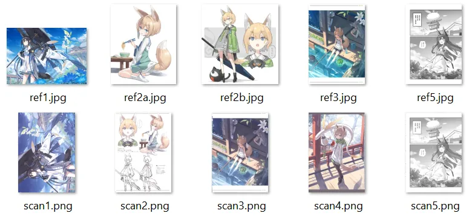

以作者的扫描仪为例，直出的彩页扫图整体偏洋红（与参考图相比 a\* 高约 5–7），暗部则偏亮、偏灰：最暗处的亮度比参考图高约 5 个 L\* 单位，黑色压不实。这些都是本工具要校正的偏差。

### 2. 添加扫图和参考图

把扫图拖到左侧列表；选中一张扫图，再把它的参考图拖到右侧「参考图」列表。运行校色时会自动对齐参考图，不需要事先旋转或裁切。

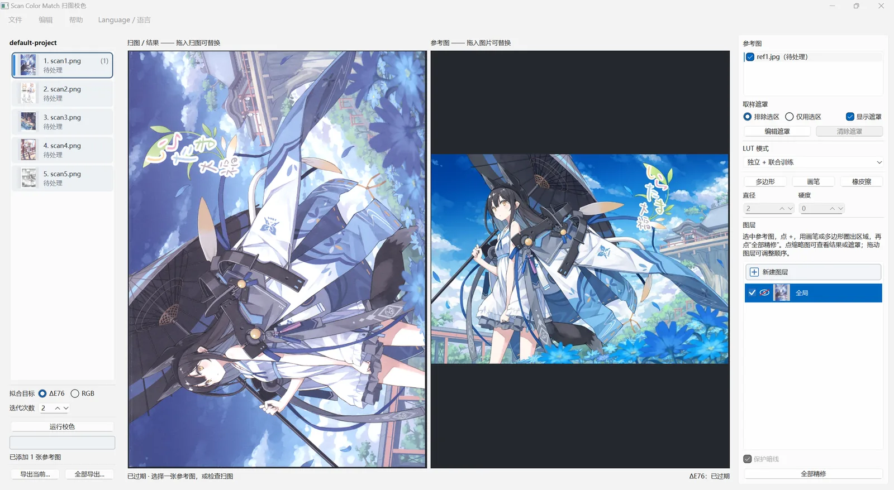

### 3. 多张参考图与取样遮罩

一张扫图对应多张参考图时，把它们全部拖进右侧参考图列表即可。

如果参考图只有一部分能和扫图对应，先在列表里选中这张参考图（①），选择「排除选区」或「仅用选区」（②），点「编辑遮罩」（③），在右侧参考图预览上圈出用于训练的部分（④）。少量线稿、文字之类的高频差异，或与扫图颜色差异极大的小块内容，在拟合时会被自动降低权重，不必画得非常精确；但成片的不对应内容需要排除。

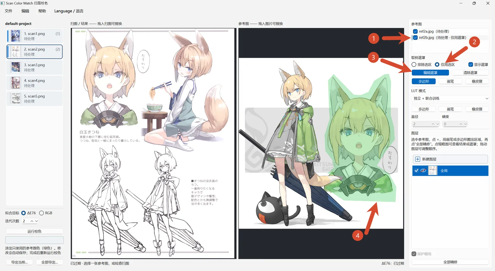

### 4. 灰度页与 LUT 模式

灰度页也能用本工具处理，但最好和彩页分批处理。这里只有一张灰度页，所以把它的 LUT 模式改为「独立 LUT」：它只用自己的参考图训练，不参与彩页的联合训练，避免污染彩页的 LUT。画集的封面、封底与内页纸张不同时，通常也应使用独立 LUT。

黑白网点漫画不适合用本工具校色：网点图的灰度来自网点面积，逐像素的颜色映射改变不了网点本身。

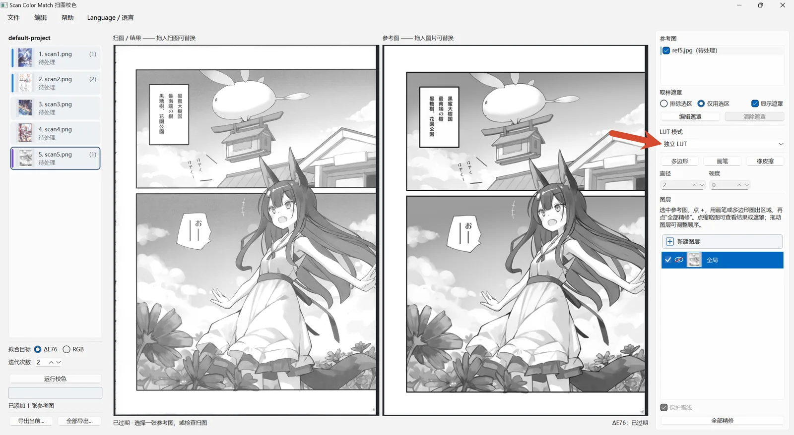

### 5. 选择拟合方式并运行

在左侧选择「拟合目标」和「迭代次数」：

- **拟合目标：** ΔE76 直接按人眼色差拟合，效果更好；RGB 拟合更快。
- **迭代次数：** 每多一轮，在上一轮的结果上再修正一次。第 2 轮通常还能把色差再降 2–8%，第 3 轮之后收益明显变小，还会越来越多地去贴合参考图里的错位和噪点。默认 2 轮。

点「运行校色」，完成后左侧预览显示校色结果。按住空格键可临时查看原扫图。

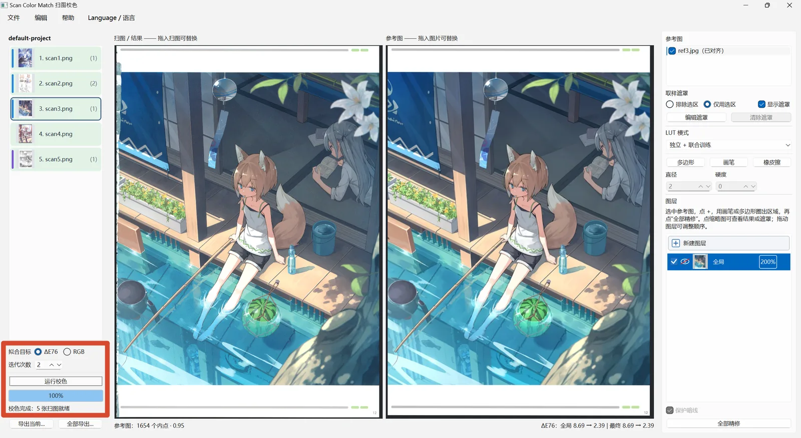

### 6. 局部精修

脸、眼睛这类面积小、细节多的地方，全局校正后颜色可能仍不够准，例如图中的西瓜。这时用局部图层精修：点「新建图层」（①），选择画笔或多边形工具（②），在扫图上画出需要调整的区域（③），然后点「全部精修」（④）。

局部图层的颜色模型比较简单，对遮罩里没有采到样本的颜色外推能力较差。所以遮罩尽量画准，颜色差别很大的几个部位最好分成多个图层，而不是塞进同一个图层。

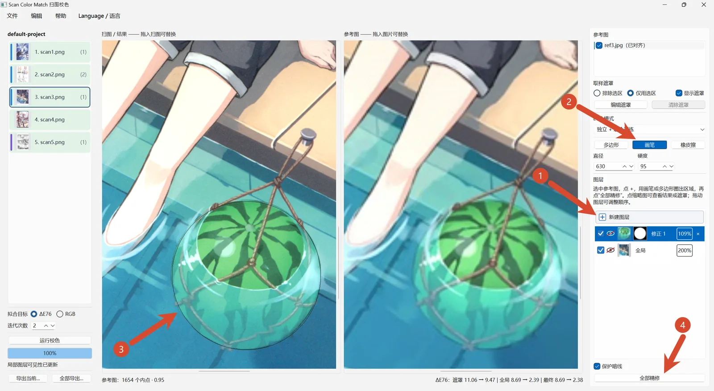

### 7. 调整强度

图层列表里每个图层右侧的百分比是强度，可点击输入或在上面滚动鼠标滚轮调整。

- **全局图层：** 100% 是第一轮的结果，每多 100% 多一轮，中间按比例插值。默认自动选择色差（ΔE76）最低的位置；调到超出已计算的轮数时会在后台补算。
- **局部图层：** 「全部精修」时自动选择遮罩内色差最低的强度。

### 8. 没有参考图的页面

没有参考图的扫图默认使用「共享 LUT」，也就是由其他参与联合训练的扫图一起学出来的 LUT。也可以在 LUT 模式里选择沿用某一张独立 LUT 扫图的 LUT，例如让封底跟随封面。

### 9. 导出与效果

点「导出当前…」或「全部导出…」导出结果。在「文件」菜单勾选「同时导出对比预览图」后，还会生成「原扫图 / 对齐后的参考图 / 修正后的结果」对比图。

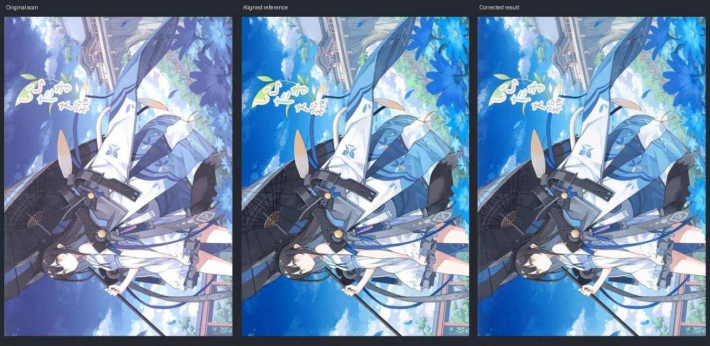
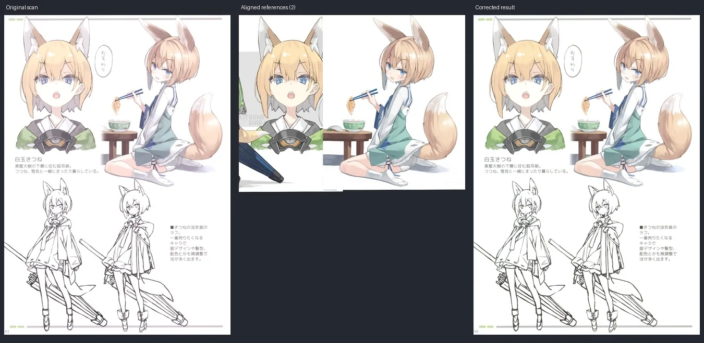
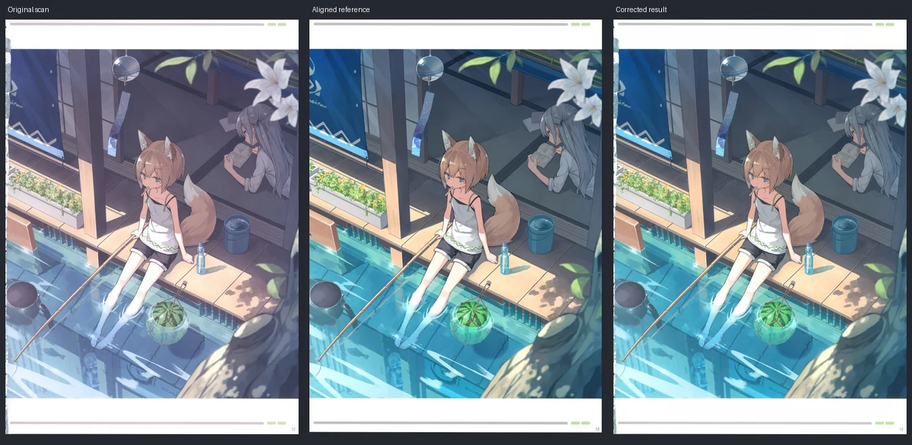

下面这张扫图在项目里没有设置参考图，完全靠其他页面联合训练的共享 LUT 校色；中间的参考图只是为了对比而另外对齐的。联合训练的几张页面里几乎没有鲜艳的红色，共享 LUT 缺少这部分颜色的训练数据，所以手中苹果糖的颜色依然不太准确。

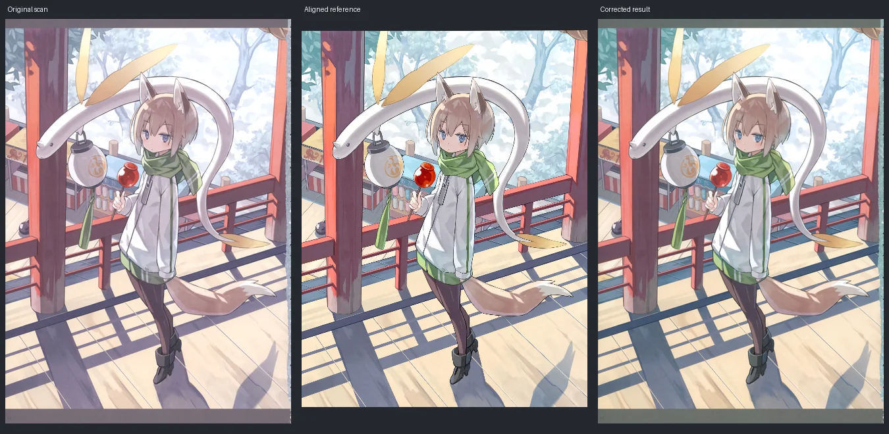
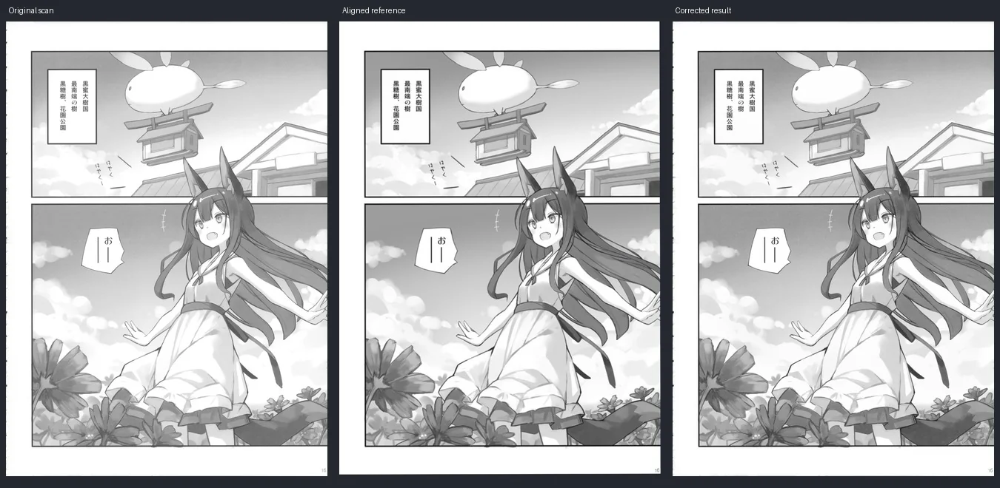

## 更多说明

完整的界面、快捷键和算法说明见 [docs/manual.zh.md](docs/manual.zh.md)。

## 许可证

[MIT](LICENSE)。示例图片版权归原作者所有，不在 MIT 许可范围内。
